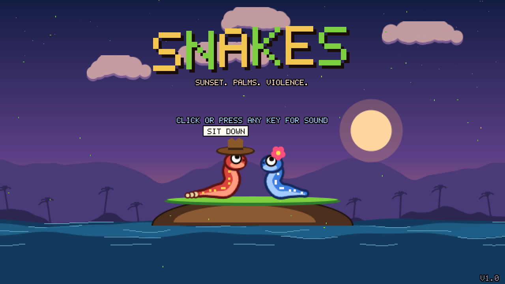
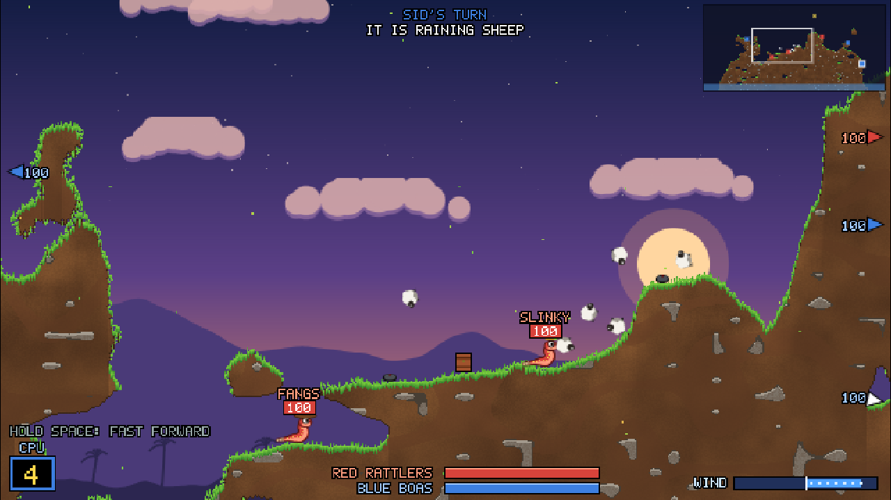
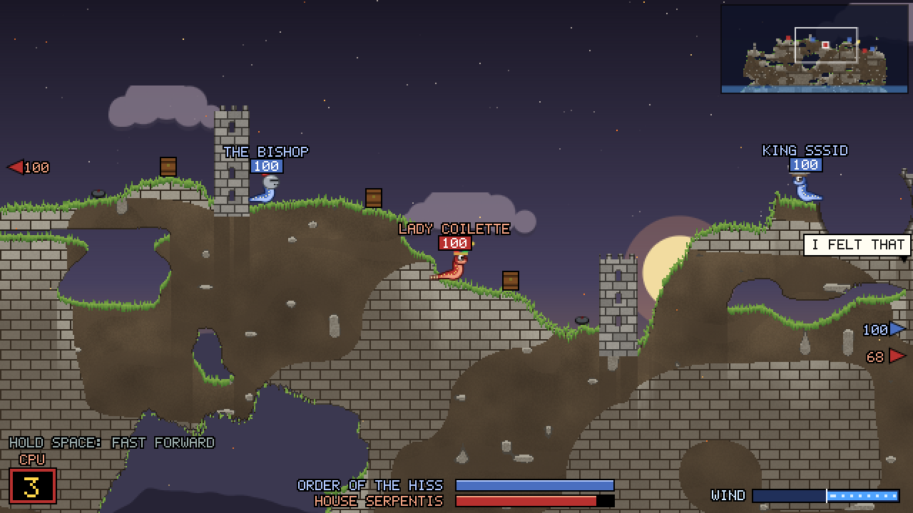
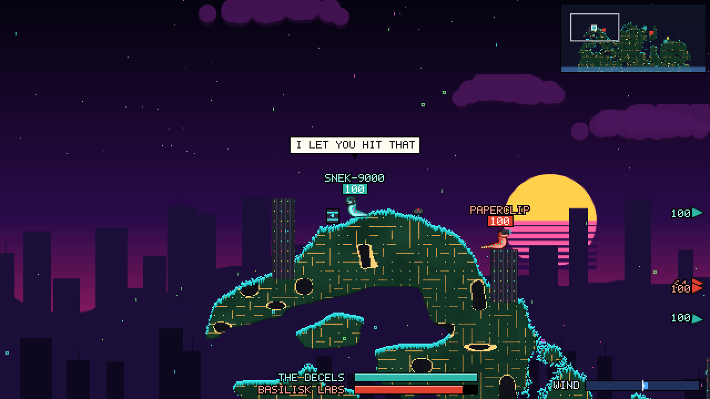
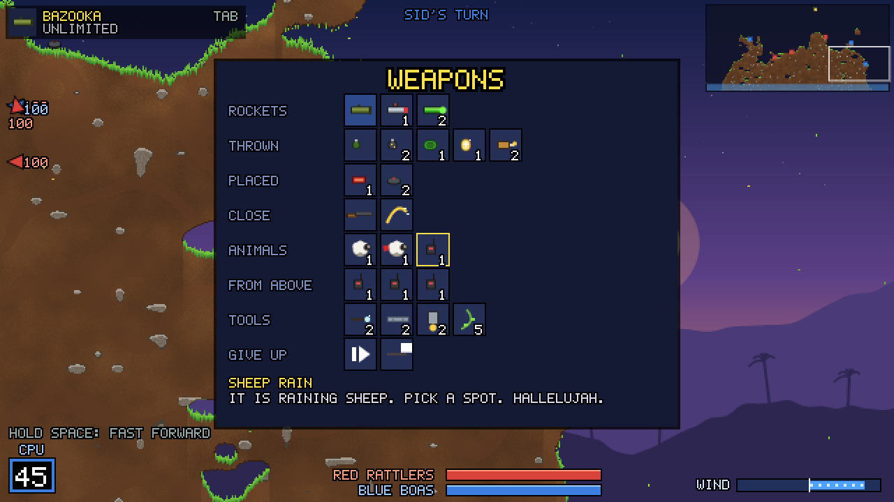

<div align="center">

# 🐍 SNAKES

### Turn-based snake artillery. Sheep rain. Holy eggs. A CPU that trolls you.

**[▶ PLAY IT NOW IN YOUR BROWSER](https://snakewizardd.github.io/snake-worms/)**

*No install. No account. Works on a keyboard, a gamepad, or a mouse.*



</div>

---

## The world

Somewhere at the end of a long summer evening, on a little island floating in a warm sea, two families of snakes have decided they cannot share it.

They have bazookas. They have grenades. They have a sheep, and when the sheep is not enough, they have a sky full of sheep. They take turns. They say rude things to each other. They get blasted off cliffs, tumble across the island, bounce off rocks, and land in the ocean with a small, dignified *splash*. Somebody always lays a shed skin where they fell.

It's the kind of game you used to pass a controller around the couch for, with every shot a little show for the room. This one remembers that feeling, and builds it again from scratch.

---

## Three worlds

<table>
<tr>
<td width="50%"></td>
<td width="50%"></td>
</tr>
<tr>
<td><b>🌴 TROPICAL ISLAND</b><br><i>Sunset. Palms. Violence.</i><br>Grass, soil, stones and a sea full of former snakes. Straw hats and flowers.</td>
<td><b>🏰 MEDIEVAL TIMES</b><br><i>Hear ye. Thou art about to be hissed.</i><br>Stone-brick ruins and castle towers you can blow apart. Knights, kings, jesters, wizards, and one plague doctor. Air strikes become trebuchet volleys.</td>
</tr>
<tr>
<td colspan="2"></td>
</tr>
<tr>
<td colspan="2"><b>💾 ACCELERATIONIST</b><br><i>The snakes have achieved AGI. It did not help.</i><br>Circuit-board islands, server racks blinking in the dark, a synthwave sun over a neon sea. <b>Basilisk Labs</b> (starring Roko's Basilisk) versus <b>The Decels</b>. VR headsets, laser eyes, galaxy brains. Your bazooka is now a Token Launcher.</td>
</tr>
</table>

Every island is generated fresh every match: caves, cliffs, floating rocks, and a different place to drown each time.

---

## The arsenal

<div align="center">

</div>

| | |
|---|---|
| **🚀 Rockets** | Bazooka · Homing Missile · Venom Spit *(poisons for 5 HP a turn)* |
| **💣 Thrown** | Grenade · Cluster Bomb · Mega Melon · **Holy Egg** *(a choir sings, then the island disappears)* · Fire Bottle |
| **🧨 Placed** | Dynamite · Mines |
| **🤜 Close** | Shotgun *(two shots)* · Tail Whip *(slap them into the sea)* |
| **🐑 Animals** | Sheep *(you detonate it)* · Sky Sheep *(it has a cape, you fly it)* · **Sheep Rain** |
| **☄️ From above** | Air Strike · **Piano Drop** *(falls through the whole island, playing a song)* · Doomsday |
| **🧰 Tools** | Teleport · Girder · Jetpack · Vine Swing |
| **🏳️ Giving up** | Skip Turn · Rage Quit *(your whole team gives up, dramatically)* |

Crates parachute in with surprise weapons and health. Mines and barrels are scattered across the map. Fire spreads. Super weapons unlock after a few rounds. In sudden death, the sea rises every turn.

---

## Play your way

**🧠 Vs CPU**: four brains to fight.

| Brain | What it's like |
|---|---|
| **Easy** | Forgets about the wind. Panics. Means well. |
| **Normal** | A solid shot who reads the wind and picks the right tool. |
| **Hard** | Simulates thousands of real shots before every turn. Knows exactly where you'll land. |
| **Troll** | Maximum disrespect. Skips turns to *"let you cook."* Builds a girder box over your head. Teleports next to you to say *"HI :)"*. Prefers the sheep. |

**🛋️ Hotseat**: two players, one keyboard or one controller, passed around the couch.

**🍿 CPU vs CPU**: put on a world, pick two brains, and watch them argue. Hold **Space** to fast-forward.

Name your team, choose how many snakes, turn time, starting health, crates, hazards, sudden death and the aim guide. The game remembers your setup next time.

---

## The vibe

The snakes talk. *"SKILL ISSUE." "WIND NERF WHEN." "TELL MY EGGS I LOVE THEM."* Land a kill and a pair of pixel sunglasses descends onto your snake. Drown someone and a single **F** rises from the waves. Get a double kill and an airhorn goes off. The killing blow plays in slow motion.

Every sprite, sound, voice and song in the game is generated by code as you play. There isn't a single image or audio file in it.

---

## Controls

| Keyboard | | Gamepad |
|---|---|---|
| **← →** | Slither | Left stick / D-pad |
| **↑ ↓** | Aim | Left stick / D-pad |
| **Hold Space** | Power up, release to fire | **A** |
| **Enter** / **Backspace** | Jump / Backflip | **B** / **X** |
| **Tab** or **right-click** | Weapon menu | **Y** |
| **Q / E** | Previous / next weapon | **RB** |
| **1 – 5** | Grenade fuse | **LB** cycles |
| **Click the map** | Aim an air strike, teleport, girder... | *Space + arrows* |
| **Mouse wheel · Z** | Zoom (all the way out to see the whole island) | |
| **WASD · drag · screen edge** | Look around | Right stick |
| **C** | Camera back to your snake | |
| **Hold Space** on a CPU turn | Fast forward | |
| **K** | Save a screenshot | |
| **Esc** | Pause, controls, new island, main menu | **Start** |

Click the minimap to jump the camera anywhere.

---

## Share it

The whole game is **one 156 KB file**: [`docs/index.html`](docs/index.html).
Download it, double-click it, and it plays offline. Send it to a friend, drop it on a USB stick, or upload it anywhere that hosts a web page.

---

<details>
<summary><b>For tinkerers</b></summary>

<br>

Built with TypeScript and Vite, with no runtime dependencies. You need [Node.js](https://nodejs.org) 20+.

```bash
npm ci              # install the exact, vetted dependency versions
npm run dev         # play locally with instant reload while you edit
npm test            # fires all 24 weapons + plays full CPU-vs-CPU matches headlessly
npm run export      # builds the single-file game into dist/snakes.html
```

Want to change how the game feels? Start here:

| File | What lives there |
|---|---|
| `src/config.ts` | Gravity, jump height, fall damage, aim speed |
| `src/themes.ts` | The three worlds: colors, teams, snake names, outfits, banter, music |
| `src/weapons.ts` | Every weapon's name, ammo, unlock round and description |
| `src/banter.ts` | Everything the snakes say |
| `src/ai.ts` | The CPU brains |

</details>

---

<div align="center">

*Made with love, in one room, in one evening, by a person and an AI who both remember the couch.*

<sub>SNAKES is an original fan-made homage to classic turn-based artillery games. It is not affiliated with, endorsed by, or connected to Team17 or the *Worms™* series. All art, audio and code are original. [MIT licensed](LICENSE): play it, fork it, remix it.</sub>

</div>
